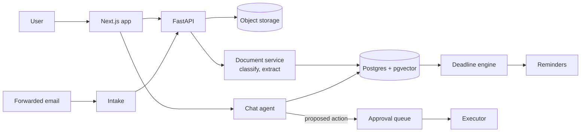

# Donna: architecture

Status: locked for v1 (Nov 2026). Donna reuses the platform from [backoffice-agents](https://github.com/mariyampangarkar19/backoffice-agents): its intake, approval queue, action executor and audit log.

## Principles this design follows

1. **Separation of concerns.** HTTP handling, business logic, LLM calls and data access live in separate layers. A route never talks to the database or the model directly.
2. **Dependencies point inward.** `domain` knows nothing about FastAPI, Postgres or any LLM vendor. Outer layers (API, adapters) depend on inner ones, never the reverse.
3. **Ports and adapters.** Every external system (database, LLM, third-party API) sits behind a small interface, so it can be swapped or faked in tests.
4. **The LLM is an untrusted component.** Its output is validated by ordinary code before anything acts on it. Safety rules are enforced in code, not in prompts.
5. **Stateless services, state in the database.** Any process can be restarted or scaled without losing work.
6. **Idempotent writes.** Reprocessing the same input never creates duplicates.
7. **Observable by default.** Every request and every model or tool call is logged with latency and cost.
8. **Start as a modular monolith.** One deployable service with clear module boundaries; split out a service only when a real need appears.

Two more that matter specifically here:

9. **Privacy by design.** Donna holds personal financial documents. Encrypt at rest, collect the minimum, redact logs, and make deletion complete and easy.
10. **Documents are data, never instructions.** Nothing inside an uploaded file can cause an action.

## Technology decisions

| Layer | Choice | Why |
|---|---|---|
| Backend | Python 3.12, FastAPI | Shared stack |
| Document understanding | Claude vision with structured outputs; one schema per document type | Handles scans, photos and mixed layouts without a separate OCR service |
| File storage | S3-compatible object storage (Supabase Storage or Cloudflare R2), server-side encryption | Files stay out of the database |
| Database | PostgreSQL 16 with pgvector, row-level security by user | Relational facts, vector search and per-user isolation in one place |
| Agent loop | Plain Python tool-use loop | Same as the shared agent platform |
| Scheduling | A daily job for reminders and a weekly job for the digest (worker cron) | Simple and reliable |
| Frontend | TypeScript, Next.js, Tailwind, shadcn/ui | Inbox, timeline, spending, chat |
| Auth | Magic-link email sign-in (Supabase Auth or Auth.js) | No passwords to store |

## System context



## Repository structure

```
donna/
  backend/
    app/
      api/            # documents, deadlines, spending, chat, actions, account
      domain/         # Document, ExtractedBill, Deadline, Transaction, MemoryFact
      documents/      # classify.py, extract.py, schemas/ (bill, receipt, contract, letter)
      deadlines/      # rules + extracted dates -> reminders
      spending/       # categorisation, monthly rollups
      chat/           # agent loop, tools (search_documents, list_deadlines, propose_action)
      memory/         # read/write of long-term facts
      adapters/       # llm, storage, repo, email
      core/
    migrations/
    tests/            # includes tests/injection/ with hostile documents
  frontend/
  evals/
  docs/               # this file, system-card.md, privacy.md
  infra/
```

## Database plan

```sql
CREATE TABLE users (
  id            uuid PRIMARY KEY DEFAULT gen_random_uuid(),
  email         citext UNIQUE NOT NULL,
  timezone      text NOT NULL DEFAULT 'Asia/Dubai',
  currency      char(3) NOT NULL DEFAULT 'AED',
  created_at    timestamptz NOT NULL DEFAULT now()
);

CREATE TABLE documents (
  id            uuid PRIMARY KEY DEFAULT gen_random_uuid(),
  user_id       uuid NOT NULL REFERENCES users(id) ON DELETE CASCADE,
  file_key      text NOT NULL,               -- object storage key
  file_sha256   text NOT NULL,
  doc_type      text CHECK (doc_type IN ('bill','receipt','contract','letter','other')),
  provider      text,
  extracted     jsonb,                       -- validated against the type's schema
  confidence    numeric(4,3),
  status        text NOT NULL DEFAULT 'processing'
                CHECK (status IN ('processing','ready','needs_review','failed')),
  received_at   timestamptz NOT NULL DEFAULT now(),
  UNIQUE (user_id, file_sha256)              -- the same file uploaded twice is one document
);

CREATE TABLE document_chunks (
  id            bigserial PRIMARY KEY,
  document_id   uuid NOT NULL REFERENCES documents(id) ON DELETE CASCADE,
  user_id       uuid NOT NULL,
  page          integer NOT NULL,
  content       text NOT NULL,
  embedding     vector(1024) NOT NULL
);
CREATE INDEX ON document_chunks USING hnsw (embedding vector_cosine_ops);

CREATE TABLE deadlines (
  id            uuid PRIMARY KEY DEFAULT gen_random_uuid(),
  user_id       uuid NOT NULL REFERENCES users(id) ON DELETE CASCADE,
  document_id   uuid REFERENCES documents(id) ON DELETE CASCADE,
  kind          text NOT NULL,               -- bill_due, contract_end, renewal, cheque_date
  title         text NOT NULL,
  due_on        date NOT NULL,
  amount        numeric(12,2),
  status        text NOT NULL DEFAULT 'open' CHECK (status IN ('open','done','dismissed')),
  UNIQUE (document_id, kind, due_on)
);
CREATE INDEX ON deadlines (user_id, due_on) WHERE status = 'open';

CREATE TABLE reminders (
  deadline_id   uuid NOT NULL REFERENCES deadlines(id) ON DELETE CASCADE,
  days_before   smallint NOT NULL,
  sent_at       timestamptz,
  PRIMARY KEY (deadline_id, days_before)     -- each reminder is sent once
);

CREATE TABLE transactions (
  id            uuid PRIMARY KEY DEFAULT gen_random_uuid(),
  user_id       uuid NOT NULL REFERENCES users(id) ON DELETE CASCADE,
  document_id   uuid REFERENCES documents(id) ON DELETE CASCADE,
  occurred_on   date NOT NULL,
  merchant      text,
  amount        numeric(12,2) NOT NULL,
  currency      char(3) NOT NULL,
  category      text NOT NULL,
  vat_amount    numeric(12,2)
);
CREATE INDEX ON transactions (user_id, occurred_on);

CREATE TABLE memory_facts (
  id            uuid PRIMARY KEY DEFAULT gen_random_uuid(),
  user_id       uuid NOT NULL REFERENCES users(id) ON DELETE CASCADE,
  key           text NOT NULL,               -- e.g. landlord_email, dewa_account
  value         text NOT NULL,
  source_document uuid REFERENCES documents(id) ON DELETE SET NULL,
  updated_at    timestamptz NOT NULL DEFAULT now(),
  UNIQUE (user_id, key)
);

-- actions and audit_log follow the shared agent platform schema, keyed by user_id.

ALTER TABLE documents ENABLE ROW LEVEL SECURITY;
CREATE POLICY own_rows ON documents USING (user_id = current_setting('app.user_id')::uuid);
-- the same policy is applied to every table that carries user_id
```

Rules: money is `numeric`, never float; deleting a user cascades to every row and a job removes their files from object storage; the database enforces per-user isolation even if application code has a bug.

## Key decisions

- **Structured facts plus vector search, not vectors alone.** "What is due this month?" is a SQL query over `deadlines`; vector search is only for free-text questions about document contents.
- **Low-confidence extractions go to review.** Below a threshold the document is marked `needs_review` and no deadline is created until the user confirms.
- **Memory is explicit key-value facts.** The user can see and edit everything Donna remembers.
